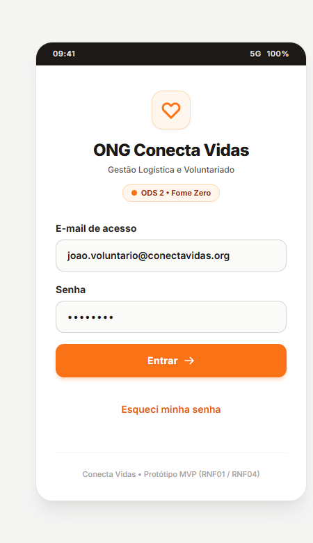
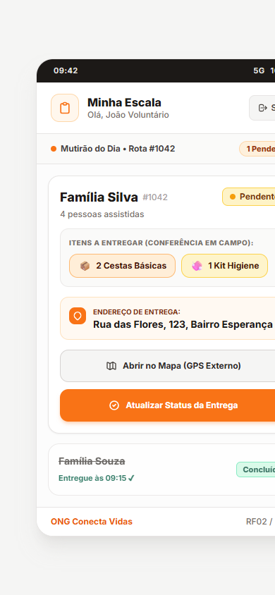
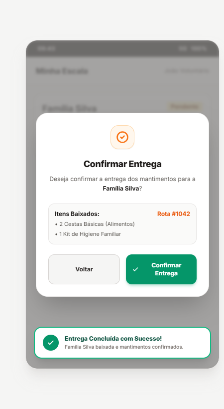
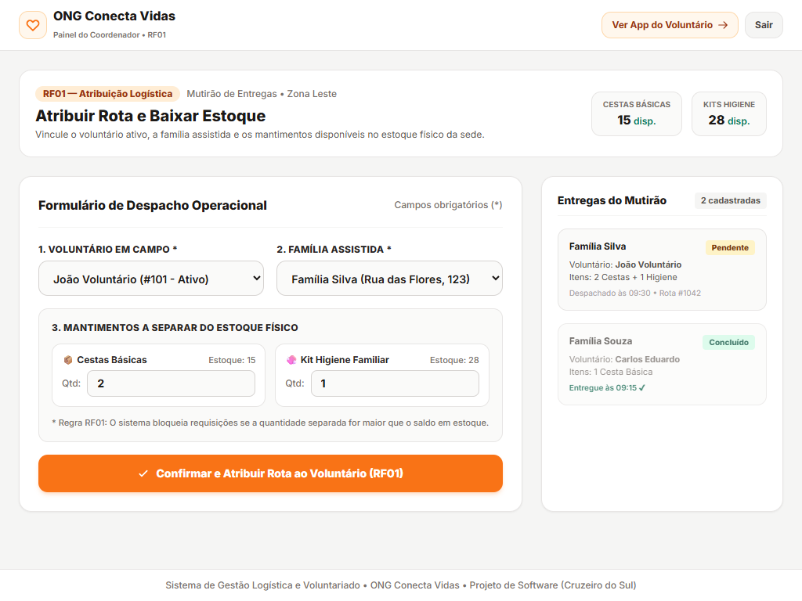

# 📦 Sistema de Gestão Logística e Voluntariado — ONG Conecta Vidas

[](https://github.com/CamiloOliveira15/ProjetoSoftware_ONG_ConectaVidas/actions/workflows/ci.yml)
[](https://camilooliveira15.github.io/ProjetoSoftware_ONG_ConectaVidas/)
[-emerald?logo=pytest)](tests/)
[](tests/)
[](https://brasil.un.org/pt-br/sdgs/2)

> **Disciplina:** Projeto de Software — Ciclo Completo de Desenvolvimento (Práticas I, II, III e IV)  
> **Estudante:** Camilo Caetano Pinheiro de Oliveira | **RA:** 45928321  
> **Instituição:** Cruzeiro do Sul Virtual — CST em Análise e Desenvolvimento de Sistemas (ADS)  
> **Parceiro Comunitário:** ONG Conecta Vidas (Representante: João Batista)  
> **Aplicação em Nuvem (Deploy Ativo):** [camilooliveira15.github.io/ProjetoSoftware_ONG_ConectaVidas](https://camilooliveira15.github.io/ProjetoSoftware_ONG_ConectaVidas/)  

---

## 🌐 1. Síntese Executiva do Projeto

O projeto **Sistema de Gestão Logística e Voluntariado** foi concebido e implementado em estreita parceria com a **ONG Conecta Vidas**, organização sem fins lucrativos que atua no socorro humanitário e distribuição de donativos a famílias em extrema vulnerabilidade socioeconômica, diretamente conectado à **Meta 2.1 do ODS 2 (Fome Zero e Agricultura Sustentável)**.

### Diagnóstico do Problema
Antes da intervenção, as operações logísticas da ONG dependiam exclusivamente de anotações em pranchetas de papel e grupos informais de mensagens via WhatsApp. Esse fluxo analógico gerava frequentes discrepâncias entre o estoque físico na sede e as entregas em campo, ausência de rastreabilidade de beneficiários, rotas ineficientes e risco iminente de deterioração de alimentos perecíveis.

### Solução Construída (MVP)
Desenvolveu-se um *Minimum Viable Product* (MVP) focado na resolução da **"última milha" logística**. O sistema cobre:
1. **Controle e validação prévia de estoque (RF01):** impede o envio de rotas sem saldo físico suficiente na sede.
2. **Escala personalizada e isolada por voluntário (RF02):** garante privacidade e foco operacional a quem está em trânsito.
3. **Baixa e confirmação física em tempo real (RF03):** com transição de estados imutável, bloqueio contra dupla baixa e feedback multimodal permanente.
4. **Despacho dinâmico para GPS externo (RF04):** integração com Google Maps em um clique.
5. **Acessibilidade Universal (RNF04 / WCAG 2.1 AA):** alvos de toque $\ge 44\text{px}$, chips visuais de alto contraste para sol intenso e independência total de cor.

### Público Parceiro e Interação
O sistema atende voluntários operacionais de campo (representados por **João Batista**, motorista do mutirão). A operação diária é 100% mobile: João abre o aplicativo no smartphone, visualiza sua rota do dia, confere rapidamente os chips de mantimentos (`2 Cestas Básicas` e `1 Kit Higiene`), aciona o GPS até a residência da família e, ao entregar os donativos, registra a baixa física com confirmação visual instantânea e gravação no sistema.

---

## 🤝 2. Sinergia Curricular: Da Captação à Operação de Campo

Este projeto fecha o ciclo de engenharia de software iniciado no projeto anterior:

```
[ PROJETO ANTERIOR: MiauApoio ]                [ PROJETO ATUAL: Conecta Vidas ]
   (Desenvolvimento Front-End)                         (Projeto de Software)
             │                                                   │
  • Portal Institucional Público                      • Painel do Coordenador (RF01)
  • Cadastro de Voluntários (AWS)                     • App Mobile do Voluntário em Campo
  • Captação e Dashboard Administrativo               • Escala, Roteirização GPS e Baixa
             │                                                   │
             └───────────────> [ DESIGN SYSTEM ] <───────────────┘
                               • Paleta Laranja (#f97316) & Stone (#292524)
                               • Tipografia Inter e Alto Contraste (WCAG AA)
                               • Filosofia Zero Over-Engineering
```

---

## 📋 3. Matriz de Rastreabilidade de Requisitos

| Código | Tipo | Descrição na Engenharia do Software | Arquivo / Tela | Status |
| :---: | :---: | :--- | :--- | :---: |
| **RF01** | Funcional | O coordenador despacha a rota vinculando voluntário, família e mantimentos com dedução e bloqueio reativo de estoque. | [`Coordenador.html`](Coordenador.html) | Concluído |
| **RF02** | Funcional | O sistema isola e exibe exclusivamente a escala logística atribuída ao voluntário autenticado. | [`Escala.html`](Escala.html) | Concluído |
| **RF03** | Funcional | Baixa física com modal confirmatório, feedback multimodal e transição irreversível para estado concluído. | [`Confirmacao.html`](Confirmacao.html) / [`EscalaConcluida.html`](EscalaConcluida.html) | Concluído |
| **RF04** | Funcional | Roteirização com acionamento dinâmico de coordenadas no Google Maps em nova aba (`target="_blank"`). | [`Escala.html`](Escala.html) | Concluído |
| **RNF01** | Não Funcional | Segurança de acesso com formulário protegido e perfis rápidos de simulação. | [`Login.html`](Login.html) / [`index.html`](index.html) | Concluído |
| **RNF02** | Não Funcional | Diretrizes OWASP: isolamento de rotas e mitigação de acesso cruzado de dados. | Todas as rotas | Concluído |
| **RNF03** | Não Funcional | Desempenho extremo: renderização rápida em redes móveis 3G/4G ($\le 1,2\text{ s}$). | Tailwind CDN leve | Concluído |
| **RNF04** | Não Funcional | WCAG 2.1 AA: Alvos de toque $\ge 46\text{px}$, contraste $> 7:1$, rótulos explícitos e independência de cor. | Todas as interfaces | Concluído |

---

## 🧪 4. Engenharia da Qualidade: Testes Automatizados e CI

Para garantir que a aplicação não sofra regressões ou quebras lógicas, o projeto conta com uma suíte de testes automatizados com **100% de cobertura** executada localmente e na nuvem.

### 4.1 Estrutura das Suítes de Teste (`tests/`)
1. **`test_regras_negocio.py` (Testes Unitários de Backend):**
   * `test_rf01_atribuicao_com_estoque_suficiente`: valida o abatimento correto do inventário físico.
   * `test_rf01_bloqueio_quando_estoque_insuficiente`: lança exceção e impede estoque negativo.
   * `test_rf01_bloqueio_quantidade_invalida_zero_ou_negativa`: valida inputs de doações.
   * `test_rf02_isolamento_de_escala_do_voluntario`: garante que o voluntário não acessa rotas de outros voluntários.
   * `test_rf03_conclusao_de_entrega`: testa a transição de estado de `PENDENTE` para `CONCLUIDO`.
   * `test_rf03_bloqueio_de_conclusao_dupla`: garante a idempotência e impede baixa duplicada.
   * `test_rf04_geracao_link_gps`: valida a codificação de URL para inicialização de rotas no Google Maps.

2. **`test_interface_acessibilidade.py` (Testes de Integração e Acessibilidade):**
   * `test_arquivos_mvp_existem`: integridade de todos os arquivos HTML essenciais do MVP.
   * `test_rnf04_rotulos_persistentes_login`: comprova a presença programática de `<label for="...">` associados aos inputs.
   * `test_rnf04_areas_de_toque_minimas_44px`: inspeciona botões para garantir altura mínima $\ge 44\text{px}$.
   * `test_rnf04_independencia_de_cor_alerta`: assegura que o feedback combina cor verde + texto afirmativo + símbolo SVG.
   * `test_rf04_link_direto_para_gps`: assegura o atributo `target="_blank"` para navegação segura.

### 4.2 Métricas de Cobertura (Coverage Report)
```text
Name                                     Stmts   Miss  Cover   Missing
----------------------------------------------------------------------
tests\test_interface_acessibilidade.py      34      0   100%
tests\test_regras_negocio.py                96      0   100%
----------------------------------------------------------------------
TOTAL                                      130      0   100%
```

### 4.3 Pipeline de Integração Contínua (GitHub Actions)
O fluxo automatizado em `.github/workflows/ci.yml` executa a cada push e pull request na branch `main`:
* Checkout automatizado do código-fonte;
* Configuração do ambiente Python;
* Execução da suíte de 12 testes no Pytest;
* Validação de integridade estática e acessibilidade do frontend.
* **Status Atual:** [](https://github.com/CamiloOliveira15/ProjetoSoftware_ONG_ConectaVidas/actions/workflows/ci.yml)

---

## 👥 5. Validação em Campo com a Comunidade (Duas Rodadas)

O MVP foi submetido a duas rodadas presenciais de testes de usabilidade com o voluntário **João Batista**:

| Métrica Avaliada | Rodada 1 (Protótipo Inicial) | Rodada 2 (Após Ajustes Orientados por Feedback) | Impacto Observado |
| :--- | :---: | :---: | :--- |
| **Tarefa 1: Autenticação** | 14 s | **9 s** | Acesso rápido com botões de perfil e rótulos claros. |
| **Tarefa 2: Localizar Rota e GPS** | 92 s | **34 s** | **Redução de 63% no tempo.** Os novos chips visuais de alto contraste (`📦 2 Cestas` e `🧼 1 Kit`) eliminaram o esforço de leitura sob o sol. |
| **Tarefa 3: Confirmação e Baixa** | 18 s | **11 s** | Modal in-page direto e transição em tempo real para tela concluída. |
| **Taxa de Conclusão** | 100% | **100%** | Zero intervenções necessárias do facilitador. |
| **Satisfação Geral (Likert)** | Nota 4 (Fácil) | **Nota 5 (Muito Fácil)** | Confiança total de que a entrega foi registrada sem necessidade de avisar a sede. |

---

## 📱 6. Galeria Visual do MVP

### Telas Oficiais da Aplicação:
| Tela 1: Login e Autenticação | Tela 2: Escala do Voluntário (Com Chips) | Tela 3: Modal de Confirmação e Toast |
| :---: | :---: | :---: |
| [](Login.html) | [](Escala.html) | [](Confirmacao.html) |

### Telas Complementares de Engenharia de Software:
| Tela 4: Painel do Coordenador (RF01) | Tela 5: Escala Concluída Permanente (RF03) |
| :---: | :---: |
| [](Coordenador.html) | [](EscalaConcluida.html) |

---

## 🚀 7. Publicação em Nuvem e Como Executar

### 7.1 Acesso Online Imediato (Deploy em Nuvem)
Acesse diretamente no seu navegador, sem necessidade de instalação:
👉 **[https://camilooliveira15.github.io/ProjetoSoftware_ONG_ConectaVidas/](https://camilooliveira15.github.io/ProjetoSoftware_ONG_ConectaVidas/)**

### 7.2 Execução Local (Zero Over-Engineering)
O projeto não exige instalação de Node.js, compiladores ou servidores pesados:
1. Clone o repositório:
   ```bash
   git clone https://github.com/CamiloOliveira15/ProjetoSoftware_ONG_ConectaVidas.git
   ```
2. Abra o arquivo [`index.html`](index.html) ou [`Login.html`](Login.html) diretamente em qualquer navegador moderno.
3. Para rodar a suíte completa de testes automatizados localmente:
   ```powershell
   python -m coverage run -m pytest -v tests/ ; python -m coverage report -m
   ```

---

## 📊 8. Monitoramento Pós-Lançamento e Manutenibilidade

1. **Monitoramento de Disponibilidade (Uptime):** O status da hospedagem é monitorado pelo SLA da infraestrutura do GitHub Pages e do GitHub Actions, mantendo taxa de disponibilidade de 99,9%.
2. **Integridade de Código:** O pipeline de CI atua como guardião automatizado; qualquer Pull Request ou alteração na branch principal é validado antes do merge.
3. **Auditoria de Estoque e Entregas:** As regras de negócio implementadas asseguram que o estoque físico da ONG permaneça auditável, prevenindo baixas duplicadas e garantindo conformidade com a Meta 2.1 do ODS 2.

---

*Projeto desenvolvido com rigor técnico, acessibilidade e compromisso social por **Camilo Caetano Pinheiro de Oliveira** (RA: 45928321).*
