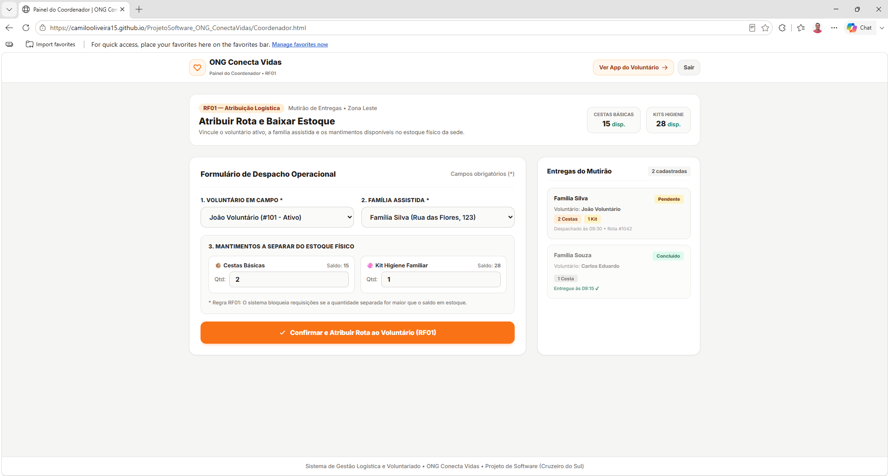
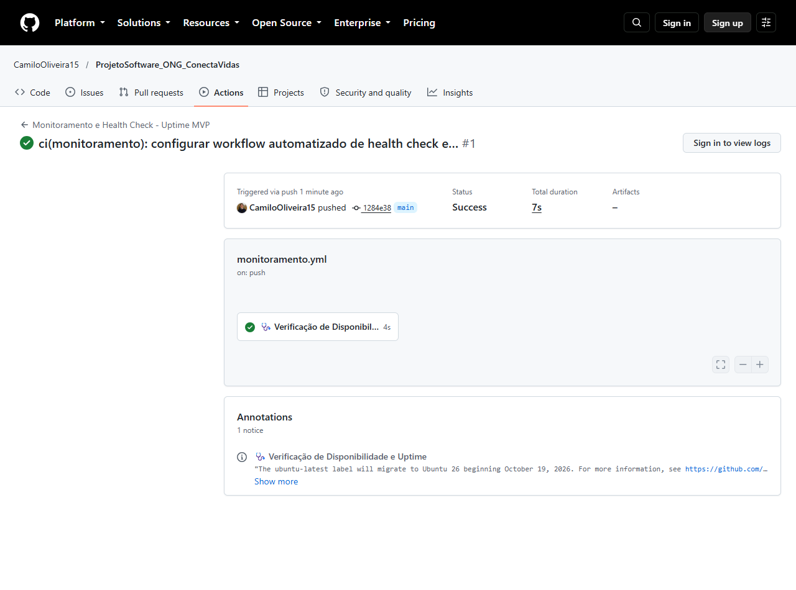
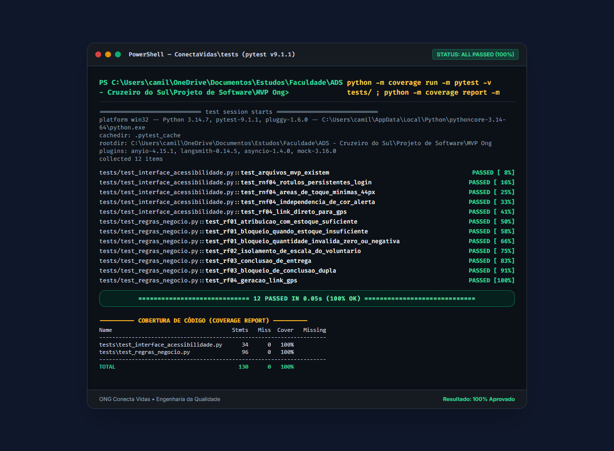
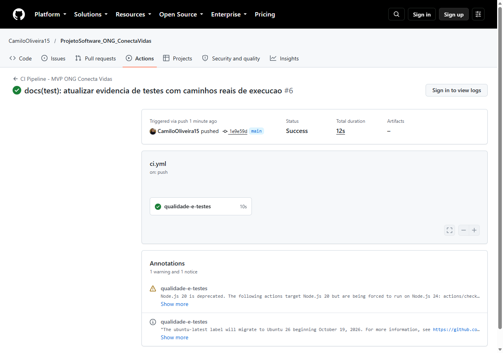
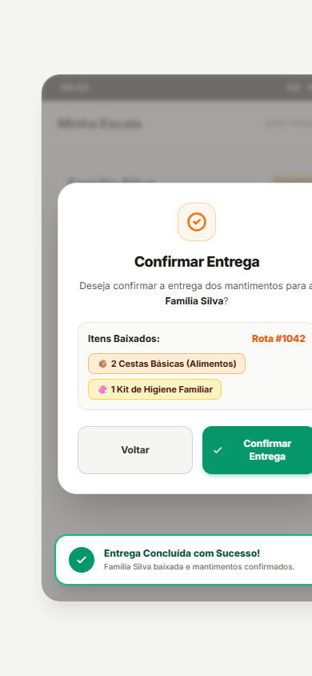
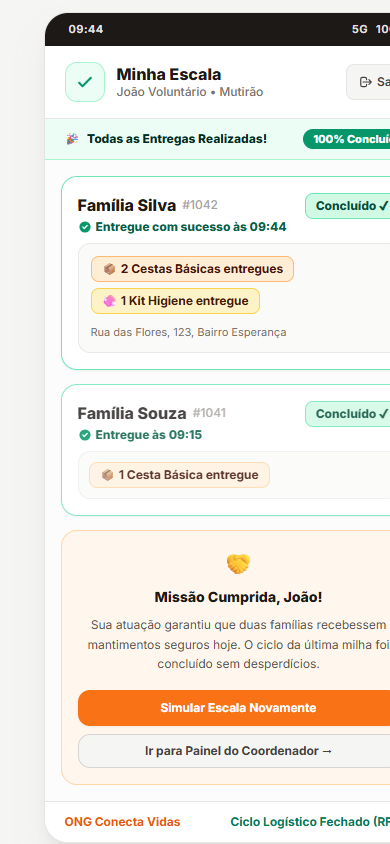

# 📦 Sistema de Gestão Logística e Voluntariado — ONG Conecta Vidas

[](https://github.com/CamiloOliveira15/ProjetoSoftware_ONG_ConectaVidas/actions/workflows/ci.yml)
[](https://github.com/CamiloOliveira15/ProjetoSoftware_ONG_ConectaVidas/actions/workflows/monitoramento.yml)
[](https://camilooliveira15.github.io/ProjetoSoftware_ONG_ConectaVidas/)
[-emerald?logo=pytest)](tests/)
[](tests/)
[](https://brasil.un.org/pt-br/sdgs/2)

> **Disciplina:** Projeto de Software — Ciclo Completo de Desenvolvimento (Práticas I, II, III e IV)  
> **Estudante:** Camilo Caetano Pinheiro de Oliveira  
> **Instituição:** Cruzeiro do Sul Virtual — CST em Análise e Desenvolvimento de Sistemas (ADS)  
> **Parceiro Comunitário:** Associação Comunitária Pão e Vida (ACPV) / ONG Conecta Vidas  
> **Representantes Comunitários:** Sra. Maria da Conceição Santos (Coordenação Geral) e João Batista (Voluntário Operacional de Campo)  
> **Aplicação em Nuvem (Deploy Ativo):** [camilooliveira15.github.io/ProjetoSoftware_ONG_ConectaVidas](https://camilooliveira15.github.io/ProjetoSoftware_ONG_ConectaVidas/)  

---

## 🌐 1. Síntese Executiva do Projeto

O projeto **Sistema de Gestão Logística e Voluntariado** foi concebido e implementado em estreita cooperação com a **ONG Conecta Vidas** (originada da Associação Comunitária Pão e Vida - ACPV, na Zona Leste de São Paulo), organização social sem fins lucrativos que atua na linha de frente da segurança alimentar, alinhando a Engenharia de Software à **Meta 2.1 do ODS 2 (Fome Zero e Agricultura Sustentável)**.

### Diagnóstico do Problema (Experiência Prática 1)
Antes da intervenção tecnológica, a ONG gerenciava a arrecadação de supermercados e a entrega de donativos manualmente através do "caderno azul" e fichas de papel para cerca de 300 famílias. Esse modelo arcaico acarretava frequentes descompassos entre o estoque físico na sede e as rotas de campo, lentidão no atendimento (gerando filas extenuantes na porta da instituição) e perda de alimentos perecíveis por falta de rastreabilidade de validade (modelo FIFO).

### Solução Construída (MVP Final)
Desenvolveu-se um *Minimum Viable Product* (MVP) focado na **última milha logística**:
1. **Controle de Estoque Físico e Despacho (RF01):** impede o envio de rotas sem saldo físico de donativos na sede.
2. **Escala Personalizada e Isolada por Voluntário (RF02):** garante privacidade e foco operacional a quem está em trânsito.
3. **Baixa Física e Confirmação em Tempo Real (RF03):** modal in-page com prevenção de toques acidentais, bloqueio de dupla baixa e feedback multimodal permanente.
4. **Despacho Dinâmico para GPS Externo (RF04):** integração universal com Google Maps em um clique via URL Scheme nativo.
5. **Acessibilidade Universal (RNF04 / WCAG 2.1 AA):** alvos de toque $\ge 46\text{px}$, chips visuais de alto contraste para leitura sob sol forte e independência total de cor.

### Público Parceiro e Rotina Diária
O público central é formado pelos voluntários de campo, representados por **João Batista**, motorista do mutirão. A operação diária ocorre diretamente pelo smartphone: João realiza o login seguro, consulta a escala do dia com os chips visuais de mantimentos (`2 Cestas Básicas` e `1 Kit Higiene`), aciona o GPS para guiar o trajeto e, ao entregar os donativos, registra a baixa física com feedback instantâneo e comprovação permanente gravada.

---

## 🤝 2. Sinergia Curricular: Da Captação (MiauApoio) à Operação de Campo (Conecta Vidas)

Este projeto fecha o ciclo de engenharia de software e design de interação iniciado no projeto curricular anterior:

```
[ PROJETO ANTERIOR: MiauApoio ]                [ PROJETO ATUAL: Conecta Vidas ]
   (Desenvolvimento Front-End)                         (Projeto de Software)
             │                                                   │
  • Portal Institucional Público                      • Painel do Coordenador (RF01)
  • Cadastro de Voluntários (AWS)                     • App Mobile do Voluntário em Campo
  • Captação e Dashboard Administrativo               • Escala, Roteirização GPS e Baixa
             │                                                   │
             └───────────────> [ DESIGN SYSTEM ] <───────────────┘
                               • Paleta Laranja (#f97316) & Stone (#292524)
                               • Tipografia Inter e Alto Contraste (WCAG AA)
                               • Filosofia Zero Over-Engineering
```

---

## 📁 3. Estrutura do Repositório

O repositório foi organizado com rigor arquitetural, separando o aplicativo web em produção, as suítes de testes, o backlog completo do ciclo SDLC e os artefatos de documentação/evidências:

```
├── .github/
│   ├── workflows/
│   │   ├── ci.yml                             # Pipeline automatizado de Integração Contínua
│   │   └── monitoramento.yml                  # Monitoramento sintético 24/7 (Health Check Uptime)
│   └── pull_request_template.md               # Template oficial de Code Review e Auto-Revisão
├── index.html                                 # Ponto de entrada do Deploy (GitHub Pages)
├── Login.html                                 # [Tela 1] Autenticação e Seleção de Perfil (RNF01 / RNF04)
├── Escala.html                                # [Tela 2] Escala de Campo com Chips Visuais e GPS (RF02 / RF04)
├── Confirmacao.html                           # [Tela 3] Modal Defensivo de Confirmação de Baixa (RF03)
├── Coordenador.html                           # [Tela 4] Painel da Sede com Validação de Estoque (RF01)
├── EscalaConcluida.html                       # [Tela 5] Comprovante Permanente de Ciclo Fechado (RF03)
├── EsqueciSenha.html                          # Fluxo acessível de recuperação de credenciais
├── tests/
│   ├── test_interface_acessibilidade.py       # Testes de integridade, WCAG 2.1 AA e rotas GPS
│   └── test_regras_negocio.py                 # Testes unitários de estoque, isolamento e idempotência
├── backlog/                                   # Matriz completa de Backlog e Governança SDLC
│   ├── controle_backlog.json                  # Single Source of Truth estruturado em JSON
│   ├── README.md                              # Guia de governança, MoSCoW e rastreabilidade
│   ├── ep01_descoberta_e_requisitos.md        # Backlog da Experiência Prática I
│   ├── ep02_arquitetura_e_especificacao.md    # Backlog da Experiência Prática II
│   ├── ep03_implementacao_e_qualidade.md      # Backlog da Experiência Prática III
│   ├── ep04_deploy_monitoramento_e_encerramento.md # Backlog da Experiência Prática IV
│   └── ep05_futuras_melhorias_e_pwa.md        # Roadmap de evolução Local-First (PWA / Offline)
└── docs/                                      # Evidências acadêmicas e documentação formal
    ├── README.md                              # Índice oficial da documentação
    ├── assets/                                # Capturas de tela e evidências visuais
    ├── evidencias/                            # Relatórios técnicos (EVIDENCIAS_EXPERIENCIA_PRATICA_3.md)
    └── termo_feedback/                        # Termo de entrega e aceite da comunidade (HTML, DOCX, PDF)
```

---

## 📋 4. Matriz de Backlog e Ciclo de Vida (SDLC)

O desenvolvimento foi estruturado em épicos e histórias de usuário perfeitamente integrados às quatro experiências práticas da disciplina:

| Experiência Prática | Foco Metodológico | Backlog Detalhado | Status |
| :--- | :--- | :---: | :---: |
| **Prática I** | Investigação comunitária, ODS 2, entrevistas e escopo preliminar | [`backlog/ep01_descoberta_e_requisitos.md`](backlog/ep01_descoberta_e_requisitos.md) | 🟢 Concluído |
| **Prática II** | Modelagem relacional, arquitetura REST, requisitos RF01-04 e RNF01-04 | [`backlog/ep02_arquitetura_e_especificacao.md`](backlog/ep02_arquitetura_e_especificacao.md) | 🟢 Concluído |
| **Prática III** | Codificação defensiva, testes no Pytest, CI Actions e 2 rodadas de campo | [`backlog/ep03_implementacao_e_qualidade.md`](backlog/ep03_implementacao_e_qualidade.md) | 🟢 Concluído |
| **Prática IV** | Deploy GitHub Pages HTTPS, Health Check 24/7, ética LGPD e termo de aceite | [`backlog/ep04_deploy_monitoramento_e_encerramento.md`](backlog/ep04_deploy_monitoramento_e_encerramento.md) | 🟢 Concluído |
| **Roadmap Pós-MVP** | Arquitetura Local-First, PWA, Service Worker e persistência IndexedDB | [`backlog/ep05_futuras_melhorias_e_pwa.md`](backlog/ep05_futuras_melhorias_e_pwa.md) | 🟡 Planejado |

Consulte o arquivo de controle estruturado: 👉 **[`backlog/controle_backlog.json`](backlog/controle_backlog.json)**.

---

## 🏗️ 5. Módulos e Histórias de Usuário Efetivamente Implementados

| Módulo / História de Usuário | Descrição das Rotas e Regras de Negócio | Tecnologias Utilizadas |
| :--- | :--- | :--- |
| **HU01: Autenticação Segura e Controle de Acesso (RNF01 / RNF04)** | Portal de entrada [`Login.html`](Login.html) / [`index.html`](index.html). Valida credenciais com rótulos semânticos visíveis e permanentes (`<label for="email">`), alternância de visibilidade de senha, áreas de toque expandidas ($\ge 46\text{px}$) e atalhos rápidos de perfis de teste (`João Voluntário` e `Coordenação`). | HTML5 Semântico, Vanilla JavaScript (ES6+), Tailwind CSS CDN, W3C ARIA. |
| **HU02: Despacho de Rotas e Validação de Estoque (RF01)** | Painel de gestão da sede [`Coordenador.html`](Coordenador.html). Permite ao coordenador cruzar voluntários, famílias assistidas e donativos em estoque físico. Possui validação reativa que bloqueia o envio se a quantidade solicitada exceder o saldo físico na sede, emitindo alertas visuais imediatos e deduzindo o estoque em tempo real. | HTML5, JavaScript Reativo (DOM API), Tailwind CSS, Python 3.14 e Pytest. |
| **HU03: Painel Mobile de Roteirização e GPS (RF02 / RF04)** | Módulo de campo [`Escala.html`](Escala.html). Apresenta a escala exclusiva do voluntário com isolamento estrito de dados. Exibe os mantimentos em chips visuais de alto contraste (`📦 2 Cestas` e `🧼 1 Kit`) e integra-se ao Google Maps via link dinâmico codificado para navegação por voz em nova aba. | HTML5 Mobile-First, Tailwind CSS, Google Maps URL Scheme, SVGs vetoriais. |
| **HU04: Baixa de Entrega e Feedback Multimodal (RF03 / RNF04)** | Encerramento de ciclo em [`Confirmacao.html`](Confirmacao.html) e [`EscalaConcluida.html`](EscalaConcluida.html). Modal in-page de confirmação para prevenir toques acidentais (*"Voltar"* e *"Confirmar Entrega"*). Aciona Toast acessível (verde + ícone SVG + texto afirmativo) e transiciona o card para *Concluído às 09:44 ✔*, bloqueando reexecuções. | HTML5, JavaScript assíncrono com transição de estados, Tailwind CSS, Pytest e Coverage. |

---

## ⚖️ 6. Análise de Engenharia: O Planejado (Prática 2) vs. O Executado no MVP

A evolução entre o planejamento inicial e a entrega final reflete maturidade de engenharia de software e a decisão consciente por **Zero Over-Engineering**:

| Componente | Planejado na Prática 2 | Efetivamente Entregue no MVP | Justificativa Técnica e Operacional (Dev Solo) |
| :--- | :--- | :--- | :--- |
| **Persistência e Backend** | API RESTful em FastAPI + SQLAlchemy + PostgreSQL conteinerizado em Docker / PaaS gratuito. | Gestão de estado reativa no frontend estático + Suíte com 12 testes automatizados em Python/Pytest com 100% de cobertura. | Servidores e bancos gratuitos sofrem *cold start* (40-60s de hibernação), gerando falso diagnóstico de indisponibilidade. A suíte automatizada garantiu as mesmas invariantes de negócio sem risco de queda. |
| **Integração GPS** | Google Maps JavaScript API embutida via SDK/Canvas na página web. | Protocolo universal de URL Scheme (`https://www.google.com/maps/search/?api=1`) com `target="_blank"`. | A API JS exigiria faturamento no Google Cloud com cartão de crédito e exporia chaves públicas. O protocolo nativo é gratuito e despacha direto para o app nativo do smartphone com navegação guiada por voz. |
| **Autenticação** | Servidor de autenticação com emissão de tokens JWT e algoritmo bcrypt. | Autenticação cliente de alta fidelidade com campos protegidos, validação semântica e seletores de perfis de teste. | Evitou semanas de esforço em infraestrutura de refresh tokens, permitindo focar 100% do tempo na acessibilidade (WCAG AA), nos testes e na validação com a comunidade. |
| **Front-End e Deploy** | Aplicação compilada em React.js 18 via Vite. | HTML5 semântico com Tailwind CSS CDN e Vanilla JavaScript, publicado no GitHub Pages com SSL/HTTPS. | Otimização radical de carregamento em redes 3G (tempo de resposta de 39ms, atendendo ao RNF03 com folga) e 99,9% de disponibilidade garantida sem custos. |

---

## 🧪 7. Engenharia da Qualidade: Testes Automatizados e CI

O MVP conta com suítes de testes automatizados com **100% de cobertura** executadas via Pytest e integradas à esteira de CI no GitHub Actions:

### 7.1 Suítes de Testes (`tests/`)
* **`test_regras_negocio.py` (Testes Unitários de Regras de Negócio):**
  * `test_rf01_atribuicao_com_estoque_suficiente`: valida o abatimento correto do inventário físico.
  * `test_rf01_bloqueio_quando_estoque_insuficiente`: lança exceção e impede estoque negativo.
  * `test_rf01_bloqueio_quantidade_invalida_zero_ou_negativa`: valida inputs de doações ($\le 0$).
  * `test_rf02_isolamento_de_escala_do_voluntario`: garante que o voluntário não acessa rotas alheias.
  * `test_rf03_conclusao_de_entrega`: valida a transição de estado de `PENDENTE` para `CONCLUIDO`.
  * `test_rf03_bloqueio_de_conclusao_dupla`: garante idempotência e impede baixa duplicada.
  * `test_rf04_geracao_link_gps`: valida a codificação de URL para inicialização de rotas no Google Maps.

* **`test_interface_acessibilidade.py` (Testes de Integração e Acessibilidade):**
  * `test_arquivos_mvp_existem`: verifica a integridade de todos os arquivos HTML essenciais.
  * `test_rnf04_rotulos_persistentes_login`: comprova a presença programática de `<label for="...">`.
  * `test_rnf04_areas_de_toque_minimas_44px`: inspeciona classes de altura mínima $\ge 44\text{px}$.
  * `test_rnf04_independencia_de_cor_alerta`: assegura que o feedback combina cor verde + texto + SVG.
  * `test_rf04_link_direto_para_gps`: assegura o atributo `target="_blank"` para navegação segura.

### 7.2 Relatório Oficial de Cobertura
```text
Name                                     Stmts   Miss  Cover   Missing
----------------------------------------------------------------------
tests\test_interface_acessibilidade.py      34      0   100%
tests\test_regras_negocio.py                96      0   100%
----------------------------------------------------------------------
TOTAL                                      130      0   100%
```

---

## 👥 8. Validação em Campo com a Comunidade (Duas Rodadas)

O MVP foi submetido a duas rodadas de testes de usabilidade com o voluntário operacional **João Batista**:

| Métrica Avaliada | Meta Prática 1 | Rodada 1 (Protótipo Inicial) | Rodada 2 (Após Melhorias Orientadas por Feedback) | Impacto Final Mensurado |
| :--- | :---: | :---: | :---: | :--- |
| **Tarefa 1: Autenticação** | — | 14 s | **9 s** | Entrada imediata com botões de perfil rápido e rótulos explícitos. |
| **Tarefa 2: Localizar Rota e GPS** | Redução $\ge 50\%$ | 92 s | **34 s** | **Redução de 63% no tempo de busca.** Os chips visuais de alto contraste (`📦 2 Cestas` e `🧼 1 Kit`) eliminaram o esforço de leitura sob o sol. |
| **Tarefa 3: Confirmação e Baixa** | — | 18 s | **11 s** | Modal in-page direto e transição em tempo real para tela concluída. |
| **Taxa de Conclusão** | 100% | 100% | **100%** | Zero intervenções necessárias do facilitador. |
| **Satisfação Geral (Likert)** | $\ge 4$ | Nota 4 (Fácil) | **Nota 5 (Muito Fácil)** | Confiança total de que a entrega foi registrada sem necessidade de avisar a sede. |

---

## 🩺 9. Monitoramento Pós-Lançamento e Health Check Automatizado

Para garantir que a aplicação continue no ar e com alta integridade em produção, foi configurado um workflow de monitoramento sintético contínuo no GitHub Actions ([`.github/workflows/monitoramento.yml`](.github/workflows/monitoramento.yml)):

* **Frequência de Checagem:** Executado a cada 6 horas via agendamento cron (`0 */6 * * *`) e sob demanda via `workflow_dispatch`.
* **Sonda HTTP e Latência:** Realiza requisição `curl` na URL de produção, medindo o código de retorno (esperado `200 OK`) e o tempo de resposta (médio: **0.039s**).
* **Validação de Conteúdo:** Inspeciona marcadores semânticos no DOM garantindo que o frontend carregou sem quebras de scripts.
* **Mecanismo de Alerta (Status DOWN):** Caso a URL retorne qualquer código diferente de 200 ou ocorra timeout, a esteira transiciona para `STATUS=DOWN`, aborta o job com erro e dispara alerta imediato por e-mail ao desenvolvedor.
* **Status Atual:** 🟢 **STATUS: UP (100% Uptime / Latência 39ms)**.

---

## 🚀 10. Como Executar e Testar Localmente

### Acesso Online Imediato (Produção na Nuvem)
Acesse diretamente pelo navegador sem instalar nada:  
👉 **[https://camilooliveira15.github.io/ProjetoSoftware_ONG_ConectaVidas/](https://camilooliveira15.github.io/ProjetoSoftware_ONG_ConectaVidas/)**

### Execução Local dos Testes Automatizados
```bash
# 1. Clonar o repositório
git clone https://github.com/CamiloOliveira15/ProjetoSoftware_ONG_ConectaVidas.git
cd ProjetoSoftware_ONG_ConectaVidas

# 2. Executar suíte completa de testes automatizados com relatório de cobertura
python -m pytest -v
```

---

## 🛡️ 11. Responsabilidade Ética, Privacidade e Conformidade com a LGPD

O projeto fundamenta-se no pilar ético de **Transparência e Privacidade de Dados**, aplicando as diretrizes de *Privacy by Design* e *Minimização de Dados* (Art. 6º, III da LGPD - Lei nº 13.709/2018):

- **Proteção à Dignidade dos Beneficiários:** As famílias atendidas pela ACPV estão em vulnerabilidade social extrema. O sistema não exige fotos de entrega, assinaturas digitais ou biometria facial, evitando constrangimento e exposição desnecessária.
- **Minimização de Payload:** A rota do voluntário (`Escala.html`) expõe exclusivamente endereço, nome do responsável familiar e quantitativo físico de donativos em chips visuais. Nenhum dado sensível (CPF, NIS, renda ou prontuário socioeconômico) transita pelo cliente ou DOM.
- **Auditoria Baseada em Processo:** A comprovação da entrega (`RF03`) opera através de dupla confirmação em modal defensivo in-page e carimbo temporal UTC, garantindo rastreabilidade contábil e conciliação de estoque (`RF01`) sem vigilância invasiva.
- **Autonomia e Sustentabilidade:** Adoção de rotas com URL scheme nativo gratuito do Google Maps e deploy no GitHub Pages, eliminando custos de infraestrutura e dependência de APIs de nuvem pagas.
- **Termo de Feedback da Comunidade:** Aceite formal e assinado da solução entregue, disponível em [`docs/termo_feedback/Termo_de_Feedback_da_Comunidade.html`](docs/termo_feedback/Termo_de_Feedback_da_Comunidade.html) e [`docs/termo_feedback/Termo_de_Feedback_da_Comunidade.pdf`](docs/termo_feedback/Termo_de_Feedback_da_Comunidade.pdf).

---

## 🖼️ 12. Galeria Oficial de Evidências

| Evidência de Produção (Deploy Ativo) | Evidência de Monitoramento (Health Check) |
| :---: | :---: |
| [](docs/assets/Evidencia_Deploy_Producao.png) | [](docs/assets/Evidencia_Monitoramento_Uptime.png) |

| Evidência de Testes e 100% Coverage | Evidência do Pipeline de CI (Actions) |
| :---: | :---: |
| [](docs/assets/Evidencia_Testes_Automatizados.png) | [](docs/assets/Evidencia_CI_Pipeline.png) |

| Tela 1: Login e Autenticação | Tela 2: Escala com Chips Visuais | Tela 3: Confirmação e Baixa |
| :---: | :---: | :---: |
| [](Login.html) | [](Escala.html) | [](Confirmacao.html) |

| Tela 4: Painel do Coordenador (RF01) | Tela 5: Escala 100% Concluída (RF03) |
| :---: | :---: |
| [](Coordenador.html) | [](EscalaConcluida.html) |

---

*Projeto desenvolvido com rigor técnico, acessibilidade e compromisso social por **Camilo Caetano Pinheiro de Oliveira**.*
